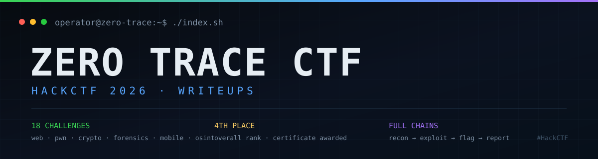

<div align="center">
  
</div>

# Zero Trace CTF — HackCTF Writeups

**18 full challenge walkthroughs from a 4th-place overall finish.** Every entry documents the
reconnaissance, the failed hypotheses, the working exploit chain, the final flag, and the
defender-side lesson. Solve scripts and the lightweight challenge artefacts are included where
they can be redistributed.

[](#result--certificate)
[](#challenge-index)
[](#coverage-at-a-glance)
[](#captured-flags)

| | |
|---|---|
| **Event** | Zero Trace CTF — HackCTF flag format, hosted on Hacklido |
| **Date** | 25 October 2026 |
| **Result** | **4th place overall** + certificate |
| **Author** | [Dhruv Mulani (@DHRUV-MULANI)](https://github.com/DHRUV-MULANI) |
| **Flag format** | `HackCTF{...}` |
| **Categories** | Web · Pwn · Crypto · Forensics · Steganography · OSINT · Mobile |

---

## Table of contents

- [Coverage at a glance](#coverage-at-a-glance)
- [Challenge index](#challenge-index)
- [Captured flags](#captured-flags)
- [Category deep dives](#category-deep-dives)
  - [Web](#web)
  - [Binary exploitation](#binary-exploitation-pwn)
  - [Cryptography](#cryptography)
  - [Forensics & steganography](#forensics--steganography)
  - [OSINT](#osint)
  - [Mobile forensics](#mobile-forensics)
  - [Audio, signals & covert channels](#audio-signals--covert-channels)
- [Additional exploit development](#additional-exploit-development)
- [How the solves were approached](#how-the-solves-were-approached)
- [Repository map](#repository-map)
- [Reproducing the solves](#reproducing-the-solves)
- [Decoys, traps and near-misses](#decoys-traps-and-near-misses)
- [Result & certificate](#result--certificate)
- [Disclaimer](#disclaimer)

---

## Coverage at a glance

| Category | Documented | Challenges |
|---|:---:|---|
| **Web** | 2 | TicketVault, Aegis Ops Console |
| **Binary exploitation (pwn)** | 2 | The Gatekeeper, Echo Chamber |
| **Cryptography** | 3 | Vault Cipher, Token Forge, Audit Log |
| **Forensics / steganography** | 6 | Flash Dump, Ghost in the Spectrogram, Whisper Twice, Matryoshka Protocol, Pauses Speak Louder, Lights Out |
| **OSINT / geolocation** | 2 | Last Ferry Out, The Lost Hotel |
| **Mobile forensics** | 2 | Ghost in the Pocket, Ouroboros |
| **Audio / signals / misc** | 1 | Static Between Stations |
| **Total** | **18** | |

Two additional pwn exploit-development efforts (First National Heap Bank and quantumVault) are
kept in the repository as working scripts, but are not counted among the 18 fully documented solves.

---

## Challenge index

| # | Challenge | Category | Primary attack / technique | Writeup |
|---:|---|---|---|---|
| 1 | **TicketVault** | Web | IDOR / broken object-level authorization on sequential ticket IDs | [Read](TicketVault_Writeup.md) |
| 2 | **Aegis Ops Console** | Web | JWT algorithm confusion `RS256 → HS256` → forged admin → SSRF loopback bypass | [Read](Aegis_Ops_Console_Writeup.md) |
| 3 | **The Gatekeeper** | Pwn | Stack over-read leak + `ret2win` on a non-PIE ELF | [Read](The_Gatekeeper_Writeup.md) |
| 4 | **Echo Chamber** | Pwn | Format-string arbitrary read (`%7$s`) of the flag in `.bss` | [Read](Echo_Chamber_Writeup.md) |
| 5 | **Vault Cipher** | Crypto | Known-plaintext attack on a raw 64-bit LCG keystream | [Read](Vault_Cipher_Writeup.md) |
| 6 | **Token Forge** | Crypto | Truncated-LCG state recovery (`state >> 32`) → seal-key derivation | [Read](Token_Forge_Writeup.md) |
| 7 | **Audit Log** | Crypto | ECDSA nonce reuse → private-key recovery → sealed-blob decryption | [Read](Audit_log_Writeup.md) |
| 8 | **Flash Dump** | Forensics | Repeating-key obfuscation on a 193-byte flash dump | [Read](Flash_dumb/WRITEUP.md) |
| 9 | **Ghost in the Spectrogram** | Forensics / stego | `debugfs` deleted-WAV recovery → LSB payload + rotated spectrogram text | [Read](Ghost_in_the_Spectrogram/WRITEUP.md) |
| 10 | **Whisper Twice** | Forensics / stego | ext4 recovery + Manchester beacon decode + `VLT1` carving + audio LSB | [Read](Whisper_Twice/whisper_twice_writeup.md) |
| 11 | **Matryoshka Protocol** | Forensics / stego | Column-major bitplane → encrypted ZIP → FSK/HDLC → reversed Morse → AES | [Read](Matryoshka_Protocol_Writeup.md) |
| 12 | **Pauses Speak Louder** | Forensics / network | DNS timing channel key + ICMP exfil + AES/zlib + LSB bitmap | [Read](Pauses_Speak_Louder/pauses-speak-louder-writeup.md) |
| 13 | **Static Between Stations** | Audio / misc | Stereo-difference spectrogram key + DTMF nibbles + repeating XOR | [Read](Static_between_stations/Static_Between_Stations_Writeup.md) |
| 14 | **Lights Out** | Forensics / stego | GIF frame XOR → damaged QR repair → appended OpenSSL blob | [Read](Lights_out/lights_out_writeup.md) |
| 15 | **Last Ferry Out** | OSINT / forensics | EXIF thumbnail/comment → LA skyline geolocation → ferry timetable | [Read](Last_Ferry_Out_Writeup.md) |
| 16 | **The Lost Hotel** | OSINT | Video geolocation → hotel identification from architectural clues | [Read](The_lost_hotel/ctf_writeup.md) |
| 17 | **Ghost in the Pocket** | Mobile forensics | Gesture-hash cracking + SQLite freelist + EXIF spoof + 7z + spectrogram | [Read](Mobile/Ghost_in_the_Pocket_Writeup.md) |
| 18 | **Ouroboros** | Mobile forensics | iOS backup + WAL frame recovery + FAT12 carving + clock-skew analysis | [Read](Mobile/Ouroboros_Writeup.md) |

> A second copy of the Ouroboros writeup exists at `Mobile/Ouroboros/Ouroboros_Writeup.md`, and a
> condensed Pauses summary exists at `Pauses_Speak_Louder_Writeup.md`. The links above point at the
> most complete version of each.

---

## Captured flags

| Challenge | Flag |
|---|---|
| TicketVault | `HackCTF{1d0r_l3ts_y0u_r34d_0th3r_t1ck3ts}` |
| Aegis Ops Console | `HackCTF{alg_c0nfus10n_th3n_ssrf_t0_l00pb4ck}` |
| The Gatekeeper | `HackCTF{r3t2w1n_sm4sh_th3_st4ck_4nd_jump}` |
| Echo Chamber | `HackCTF{f0rm4t_str1ng_l34k_th3_s3cr3t}` |
| Vault Cipher | `HackCTF{r0ll_y0ur_0wn_lcg_r0lls_0v3r}` |
| Token Forge | `HackCTF{trunc4t3d_lcg_st1ll_l34ks_th3_st4t3}` |
| Audit Log | `HackCTF{match_th3_k3y_n0t_just_th3_r}` |
| Flash Dump | `HackCTF{add1t1v3_c1ph3rs_4r3nt_x0r}` |
| Ghost in the Spectrogram | `HackCTF{sp3ctr0gr4m_gh0sts_n3v3r_d13}` |
| Whisper Twice | `HackCTF{n0_0n3_h34rd_th3_gh0st_wh1sp3r_tw1c3}` |
| Matryoshka Protocol | `HackCTF{m4tryoshka_pr0t0c0l_n0_sh0rtcut_5d8e}` |
| Pauses Speak Louder | `HackCTF{t1m1ng_1s_3v3ryth1ng_gh0st_pr0t0c0l}` |
| Static Between Stations | `HackCTF{st4t1c_b3tw33n_st4t10ns_7f3a}` |
| Lights Out | `HackCTF{bl4ck_1s_n0t_3mpty_9c21}` |
| Last Ferry Out | `HackCTF{18-Feb-2024_23:41}` |
| The Lost Hotel | `HackCTF{novotel_singapore_clarke_quay}` |
| Ghost in the Pocket | `HackCTF{sp3ctr0gr4m_1n_th3_fr33l1st_Z}` |
| Ouroboros | `HackCTF{w4l_fr4m3s_n3v3r_f0rg3t_0uroboros}` |

---

## Category deep dives

Each section below summarises the challenge, the path that worked, and the artefacts retained in
the repository. The linked writeup is the authoritative, step-by-step version.

### Web

#### TicketVault — IDOR / BOLA

A Flask support-desk portal with a demo `guest / guest` account. The ticket **listing** is scoped to
the session user, but the detail route `/ticket/<id>` authenticates without authorising. Sequential
numeric IDs expose every other user's tickets, including `it-admin` ticket `#1007` that carries the
flag. A planted `security-team` "HONEYPOT" ticket at `#1028` contains a decoy flag and is explicitly
rejected in the writeup.

- **Lesson:** collection-level scoping is not object-level authorisation.
- **Files:** [`TicketVault_Writeup.md`](TicketVault_Writeup.md) (challenge VPN profile intentionally not published).

#### Aegis Ops Console — JWT confusion → SSRF

The console publishes its RS256 verification key and trusts the token's `alg` header. Re-signing an
admin token with `HS256`, using the public PEM as the HMAC secret, yields admin access. The
admin-only `/console/fetch?url=` endpoint performs server-side requests behind a string denylist;
the decimal form `http://2130706433:5000/internal/flag` reaches loopback and returns the flag.

- **Chain:** public key → algorithm confusion → forged admin JWT → SSRF → numeric loopback bypass.
- **Files:** [`Aegis_Ops_Console_Writeup.md`](Aegis_Ops_Console_Writeup.md).

### Binary exploitation (pwn)

#### The Gatekeeper — leak + ret2win

A non-PIE ELF reads 256 bytes into a 64-byte stack buffer and prints it without reliable
null-termination. Short inputs leak the saved RBP and return address; 72 bytes of padding plus the
hidden `staff_door` address (`0x40125b`) redirects execution and prints the flag.

- **Files:** [`The_Gatekeeper_Writeup.md`](The_Gatekeeper_Writeup.md), [`The_Gatekeeper/exploit.py`](The_Gatekeeper/exploit.py).

#### Echo Chamber — format-string arbitrary read

The service passes user input directly to `printf(buf)`. The flag file is already read into a fixed
`.bss` buffer at `0x4040a0` in a non-PIE binary, so a single `%7$s` with the address placed in the
right argument slot reads it back.

```python
payload = b"%7$sAAAA" + p64(0x4040a0)
```

- **Files:** [`Echo_Chamber_Writeup.md`](Echo_Chamber_Writeup.md).

### Cryptography

#### Vault Cipher — raw LCG keystream

The backup agent XORs the **full 64-bit LCG state** into the plaintext. Every export begins with the
constant magic `VAULTv01`, which recovers the first eight keystream bytes and therefore the first
state. The rest of the keystream is deterministic. The decrypted export contains a `legacy-import`
decoy and the real `recovery-kit` secret.

- **Files:** [`Vault_Cipher_Writeup.md`](Vault_Cipher_Writeup.md), [`Vault_Cipher/cipher.py`](Vault_Cipher/cipher.py), [`Vault_Cipher/solve.py`](Vault_Cipher/solve.py), [`Vault_Cipher/capture.bin`](Vault_Cipher/capture.bin).

#### Token Forge — truncated LCG state recovery

Request IDs publish `state >> 32`, and the admin reset token is sealed with a key derived from the
next **full** state. Ten consecutive IDs plus known recurrence constants leave only the low 32 bits
unknown. Brute-forcing that space against the next nine IDs yields exactly one candidate, the full
state chain, and the seal key.

```text
state11 = 0x426a53911d4bc615  ->  SHA256("reqid-seal-" + str(state11))  ->  unseal
```

- **Files:** [`Token_Forge_Writeup.md`](Token_Forge_Writeup.md), [`Token_Forge/tokengen.py`](Token_Forge/tokengen.py), [`Token_Forge/solve.py`](Token_Forge/solve.py), [`Token_Forge/solve.c`](Token_Forge/solve.c), [`Token_Forge/request_ids.log`](Token_Forge/request_ids.log), [`Token_Forge/admin_reset.sealed`](Token_Forge/admin_reset.sealed).

#### Audit Log — ECDSA nonce reuse

Two `fw-prod` signatures reuse the same nonce `k`, exposing the same `r`. Recovering
`k = (z1 - z2) / (s1 - s2) mod n` and `d = (s1·k - z1) / r mod n` reproduces the published public key
and yields the sealing key. The writeup includes the verification step that proves the recovered key
is correct before decrypting the blob.

- **Files:** [`Audit_log_Writeup.md`](Audit_log_Writeup.md), [`Audit_log/solve.py`](Audit_log/solve.py), [`Audit_log/audit.log.jsonl`](Audit_log/audit.log.jsonl), [`Audit_log/release.sealed`](Audit_log/release.sealed).

### Forensics & steganography

#### Flash Dump — repeating-key obfuscation

A 193-byte flash region with a "repeating rhythm" and a vendor that is "not famous for real
cryptography". Period analysis and a known-plaintext crib recover the repeating additive/XOR key and
the break-glass note.

- **Files:** [`Flash_dumb/WRITEUP.md`](Flash_dumb/WRITEUP.md), [`Flash_dumb/flash.bin`](Flash_dumb/flash.bin).

#### Ghost in the Spectrogram — deleted WAV, two channels

An ext4 evidence image contains one deleted inode (`debugfs lsdel`) for a stereo WAV. The right
channel carries `GHST` + a big-endian length + an OpenSSL `Salted__` blob; the left channel's
spectrogram holds `ECHO-7-LANTERN` rotated 180°. The declared 64-byte length is the exact blob size —
everything after it is decoy.

- **Files:** [`Ghost_in_the_Spectrogram/WRITEUP.md`](Ghost_in_the_Spectrogram/WRITEUP.md), helper scripts [`sweep.py`](Ghost_in_the_Spectrogram/sweep.py), [`seg.py`](Ghost_in_the_Spectrogram/seg.py), [`ascii2.py`](Ghost_in_the_Spectrogram/ascii2.py), [`tryall.py`](Ghost_in_the_Spectrogram/tryall.py).

#### Whisper Twice — four-stage forensic chain

Filesystem recovery (`debugfs`) → PCAP beacon decoding (Manchester, with retransmit handling) →
carving `VLT1` records and CRC-checking them → AES decryption → audio LSB extraction and XOR. The
writeup records the failed NRZ attempt and the wrong-channel/wrong-reversal attempts, which are as
useful as the final path.

- **Files:** [`Whisper_Twice/whisper_twice_writeup.md`](Whisper_Twice/whisper_twice_writeup.md), [`decode_beacon.py`](Whisper_Twice/decode_beacon.py), [`vault_parse.py`](Whisper_Twice/vault_parse.py), [`scan_image.py`](Whisper_Twice/scan_image.py), [`hspec.py`](Whisper_Twice/hspec.py).

#### Matryoshka Protocol — the nesting-doll challenge

`relic.png` hides a password-protected ZIP after `IEND`. The password (`relic-9Q4x-cipher`) is stored
in **column-major** bit order — "Rows lie. Columns don't." Inside the ZIP: a stereo tape with an FSK
frame (1800/2600 Hz, 100 baud, HDLC-style `0x7E` framing, CRC32) on the left and reversed Morse on
the right. Reversing the Morse yields `NULLSECTOR9`; lowercasing it decrypts the AES-256-CBC blob.

- **Files:** [`Matryoshka_Protocol_Writeup.md`](Matryoshka_Protocol_Writeup.md), [`Matryoshka_Protocol/signal.enc`](Matryoshka_Protocol/signal.enc), [`Matryoshka_Protocol/signal_clean.enc`](Matryoshka_Protocol/signal_clean.enc).

#### Pauses Speak Louder — timing key, packet message

DNS query inter-arrival times to `update.cdn-sync.net` encode a 16-byte key (0.20 s = `0`, 0.55 s =
`1`). The payload travels in 52 sequenced ICMP echo requests, AES-128-CBC encrypted and
zlib-compressed. The decrypted PCM audio hides a bitmap font in sample LSBs with alternating-row
inversion.

- **Files:** [`Pauses_Speak_Louder/pauses-speak-louder-writeup.md`](Pauses_Speak_Louder/pauses-speak-louder-writeup.md), [`Pauses_Speak_Louder/capture.pcap`](Pauses_Speak_Louder/capture.pcap).

#### Lights Out — XOR two frames, repair the QR

A 40-frame near-black GIF. Frames 9 and 31 XOR into a QR code with its finder patterns erased. After
repairing the finders, the QR decodes to `ph4nt0m-sign4l-7731`, which decrypts 64 bytes appended
after the GIF trailer (`Salted__` / AES-256-CBC / PBKDF2).

- **Files:** [`Lights_out/lights_out_writeup.md`](Lights_out/lights_out_writeup.md).

### OSINT

#### Last Ferry Out — location and departure time

The photo metadata exposes a base64 comment (`bjBydGhzdDRyNw==`) and an embedded thumbnail. The
thumbnail preserves what the large image lost: the location resolves to the Los Angeles skyline /
ferry terminal, and the ferry timetable pins the departure to `18-Feb-2024 23:41`.

- **Files:** [`Last_Ferry_Out_Writeup.md`](Last_Ferry_Out_Writeup.md), small thumbnails and voicemail retained locally.

#### The Lost Hotel — architectural geolocation

A hotel-room video plus a Google Drive folder. Landmarks, room layout and exterior views identify the
property as **Novotel Singapore Clarke Quay**, matching the four-word, 7-9-6-4 flag format.

- **Files:** [`The_lost_hotel/ctf_writeup.md`](The_lost_hotel/ctf_writeup.md).

### Mobile forensics

#### Ghost in the Pocket — Android acquisition

A partial `/data` dump. The solve cracks the unsalted SHA-1 gesture hash to `Z`, carves deleted SMS
records from the SQLite freelist to learn the archive-password rule, detects a spoofed EXIF
thumbnail, reconstructs the true GPS/time values (`0214`, `18.520`), opens the `.thumbcache.dat`
7-Zip container, and reads the flag from a spectrogram.

- **Files:** [`Mobile/Ghost_in_the_Pocket_Writeup.md`](Mobile/Ghost_in_the_Pocket_Writeup.md).

#### Ouroboros — iOS backup and anti-forensics

An iTunes-style backup with hashed filenames in `Manifest.db`. The challenge requires recovering
deleted SQLite records from WAL frames before checkpoint, carving a deleted image from a FAT12 USB
image, reconciling clock skew between `events` and `app_usage`, and deriving the PBKDF2/AES vault key.

- **Files:** [`Mobile/Ouroboros_Writeup.md`](Mobile/Ouroboros_Writeup.md), duplicate at [`Mobile/Ouroboros/Ouroboros_Writeup.md`](Mobile/Ouroboros/Ouroboros_Writeup.md).

### Audio, signals & covert channels

#### Static Between Stations — "Mono is a lie"

Subtracting the stereo channels reveals a second broadcast. Its 16.4–19.1 kHz spectrogram reads
`STATIC`, the XOR key. The main programme contains 74 DTMF tones between 22.0 s and 36.7 s; mapping
`* → E`, `# → F` gives hexadecimal nibbles whose 37 bytes XOR against `STATIC` produce the flag.

- **Files:** [`Static_between_stations/Static_Between_Stations_Writeup.md`](Static_between_stations/Static_Between_Stations_Writeup.md).

---

## Additional exploit development

These are working scripts and notes from pwn efforts that did not get a standalone writeup.

| Target | Notes | Scripts |
|---|---|---|
| **First National Heap Bank** | UAF after `close`, unsorted-bin libc leak, tcache poisoning, `__free_hook = system`; includes heap-layout scanners and multiple glibc build offsets. Exfiltration via `/proc/self/mem` was still being refined. | [`bank.py`](First_nATIONAL_HEAP_bANK/bank.py), [`exploit.py`](First_nATIONAL_HEAP_bANK/exploit.py), [`solve.py`](First_nATIONAL_HEAP_bANK/solve.py), [`leak_check.py`](First_nATIONAL_HEAP_bANK/leak_check.py), [`scan_sizes.py`](First_nATIONAL_HEAP_bANK/scan_sizes.py), [`test_poison.py`](First_nATIONAL_HEAP_bANK/test_poison.py) |
| **quantumVault** | Stack over-read leaks the canary and a libc return address; ret2libc ROP chain with `pop rdi; ret` and a stack-alignment `ret`. | [`exploit.py`](quantumVault/exploit.py), [`script.py`](quantumVault/script.py) |

`PostMaster` and `Acme_Remote_Syslog_Collector` are retained only as empty challenge directories / VPN
profile placeholders; no solve artefacts survived.

---

## How the solves were approached

The same loop was used across every category:

1. **Triage the artefacts** — `file`, `exiftool`, `binwalk`, `strings`, `xxd`, `tshark`, `debugfs`.
   Establish what is original, what is generated, and what is decoy.
2. **Extract the hint from the prompt** — challenge text and titles encode the primitive
   ("Rows lie. Columns don't", "Mono is a lie", "The key is in the pauses"). Write the hypothesis
   down before touching tooling.
3. **Build the smallest possible proof** — one packet, one frame, one signature, one ciphertext.
   Confirm the primitive in isolation before writing a full solver.
4. **Automate the repeatable part** — pcaps, bitplanes, FSK/Morse, DTMF, SQLite carving and LCG
   brute force all become short Python scripts in the challenge directory.
5. **Chain to the flag** — web findings escalate from auth bypass to SSRF; crypto findings escalate
   from key recovery to sealed-blob decryption; forensic findings escalate from deleted file to
   decrypted payload.
6. **Check for decoys before submitting** — see the next section. Several challenges deliberately
   plant a plausible flag-shaped string earlier in the data.
7. **Write the negative results down** — the failed transforms, wrong channels and rejected
   hypotheses are the difference between a solution and a story.

### Tooling used

`python3` (pwntools, cryptography, numpy, scipy, Pillow, matplotlib), `tshark` / `tcpdump`,
`binwalk`, `foremost`, `debugfs`, `exiftool`, `ffmpeg`, `sox`, `zsteg`-style bit extraction,
`openssl`, `sqlite3`, `radare2` / `objdump` / `ROPgadget`, `ghidra`, `nmap`, `curl`, `Burp Suite`,
`jwt_tool`, and custom Python for signals and covert channels.

---

## Repository map

```text
Zero_trace/
├── README.md                        <- this index
├── LICENSE
├── assets/
│   └── banner.svg
│
├── TicketVault_Writeup.md           # Web / IDOR
├── Aegis_Ops_Console_Writeup.md     # Web / JWT confusion + SSRF
├── The_Gatekeeper_Writeup.md        # Pwn / ret2win
├── The_Gatekeeper/exploit.py
├── Echo_Chamber_Writeup.md          # Pwn / format string
├── Vault_Cipher_Writeup.md          # Crypto / LCG keystream
├── Vault_Cipher/{cipher.py,solve.py,capture.bin}
├── Token_Forge_Writeup.md           # Crypto / truncated LCG
├── Token_Forge/{tokengen.py,solve.py,solve.c,request_ids.log,admin_reset.sealed}
├── Audit_log_Writeup.md             # Crypto / ECDSA nonce reuse
├── Audit_log/{solve.py,audit.log.jsonl,release.sealed}
│
├── Flash_dumb/
│   ├── WRITEUP.md                   # Forensics / repeating key
│   └── flash.bin
├── Ghost_in_the_Spectrogram/
│   ├── WRITEUP.md                   # Forensics / deleted WAV + spectrogram
│   └── *.py, extracted.bin, blob64.bin, flag.txt
├── Whisper_Twice/
│   ├── whisper_twice_writeup.md     # Forensics / multi-stage
│   └── decode_beacon.py, vault_parse.py, scan_image.py, hspec.py, ...
├── Matryoshka_Protocol_Writeup.md   # Forensics / nested stego + signals
├── Matryoshka_Protocol/{signal.enc,signal_clean.enc}
├── Pauses_Speak_Louder/
│   ├── pauses-speak-louder-writeup.md
│   └── capture.pcap
├── Pauses_Speak_Louder_Writeup.md   # condensed summary (older wording)
├── Lights_out/
│   └── lights_out_writeup.md        # Forensics / GIF XOR + QR
├── Static_between_stations/
│   └── Static_Between_Stations_Writeup.md
│
├── Last_Ferry_Out_Writeup.md        # OSINT / geolocation + timetable
├── Last_Ferry_Out/{thumb.jpg,extracted_thumb.jpg,voicemail.wav}
├── The_lost_hotel/
│   └── ctf_writeup.md               # OSINT / hotel identification
│
├── Mobile/
│   ├── Ghost_in_the_Pocket_Writeup.md
│   └── Ouroboros_Writeup.md
│
├── First_nATIONAL_HEAP_bANK/        # pwn exploit development
│   └── bank.py, exploit.py, solve.py, leak_check.py, ...
├── quantumVault/                    # pwn exploit development
│   └── exploit.py, script.py
├── PostMaster/                      # no retained artefacts
└── Acme_Remote_Syslog_Collector/    # no retained artefacts
```

> **Not published:** VPN profiles (they contain a private key and user certificate), virtual
> environments, extracted device dumps, disk images, multi-hundred-MB evidence media and the
> thousands of generated spectrogram PNGs. The writeups name every original artefact and describe
> how to regenerate the derived ones.

---

## Reproducing the solves

Most scripts are standalone. Install the common dependencies:

```bash
python3 -m venv .venv && source .venv/bin/activate
pip install pwntools cryptography numpy scipy pillow matplotlib pycryptodome requests
```

Forensics scripts expect the original artefacts in the same directory and use relative paths. The
remote hosts in the pwn/web scripts (`10.10.0.x`) were specific to the event VPN and are no longer
reachable; point them at a local replay or your own instance.

---

## Decoys, traps and near-misses

The event leaned heavily on planted false positives. These are worth studying on their own:

| Challenge | Decoy | Why it is not the flag |
|---|---|---|
| TicketVault | Ticket `#1028`, titled "HONEYPOT -- do not submit" | Self-declared decoy owned by `security-team` |
| Vault Cipher | `legacy-import` record | Explicitly labelled `deprecated, do not use`; the requested `recovery-kit` record is the real one |
| Token Forge | `preview_token` | The honest JSON distinguishes `preview_token` from `admin_reset_token` |
| Ghost in the Spectrogram | `CTF{n1c3_try...}` | Wrong flag format; the real flag uses `HackCTF{...}` |
| Pauses Speak Louder | Audio bitmap `15` vs `1s` | Glyph analysis resolves the OCR ambiguity to `1s` ("is") |
| First National Heap Bank | libc base candidates for multiple glibc builds | Page-alignment check rejects the wrong build |
| Matryoshka Protocol | Straight row-major bitplane read | Returns garbage; the hint says columns, not rows |

The recurring lesson: **validate context, not just format.** A regex that matches `HackCTF{...}` will
happily return the wrong answer.

---

## Result & certificate

<div align="center">

### 🏅 4th Place Overall — Zero Trace CTF 2026

**18 documented solves across web, pwn, crypto, forensics, OSINT, mobile and signal analysis.**

</div>

The official 4th-place certificate was awarded for this result. To display it in this repository,
drop the image at `assets/certificate.png`; the path is already excluded from the blanket PNG
ignore rule.

---

## Disclaimer

All testing was performed against official CTF infrastructure during the event, under the event
rules and VPN scope. Flags are published after the competition for educational purposes. Nothing in
this repository authorises testing against real systems. The techniques shown — IDOR, JWT confusion,
SSRF, memory corruption, nonce reuse, covert channels — are documented to help defenders recognise
and fix them.

---

<p align="center">
  <sub>Built by <a href="https://github.com/DHRUV-MULANI">Dhruv Mulani</a> · HackCTF / Zero Trace CTF 2026</sub>
</p>
