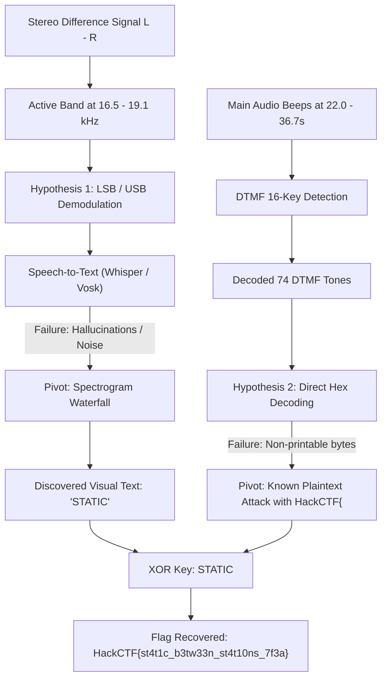

# Static Between Stations - CTF Writeup

**Challenge Name:** Static Between Stations  
**Category:** Misc / Audio Steganography / Cryptography  
**Points:** 100  
**Flag Format:** `HackCTF{...}`  
**Provided Files:** `broadcast.wav` (38.8 s, 44100 Hz, 16-bit Stereo PCM)  
**Hint:** "Mono is a lie"  

---

## 1. Executive Summary

"Static Between Stations" is a multi-stage audio steganography challenge disguised as a noisy pirate radio recording. The challenge flavor text notes that listeners heard "static and a few beeps", but "nobody noticed that the speakers were playing two different broadcasts". 

Solving the challenge required:
1. Isolating the stereo difference signal $D(t) = \frac{L(t) - R(t)}{2}$ to reveal the second broadcast.
2. Generating a spectrogram of $D(t)$ in the 16.4 kHz – 19.1 kHz region to read the visual text **`STATIC`** (the encryption key).
3. Decoding a sequence of 74 DTMF tones in the main audio (22.0 s – 36.7 s) using Goertzel / FFT filtering.
4. Mapping the DTMF symbols to hexadecimal nibbles (`*` $\to$ `E`, `#` $\to$ `F`) and XORing the resulting 37 bytes with the repeating key `STATIC`.

Final Flag: **`HackCTF{st4t1c_b3tw33n_st4t10ns_7f3a}`**

---

## 2. Initial Reconnaissance & Clues

### File Inspection
- **Format:** RIFF WAV audio, 2 channels (stereo), 44,100 Hz, 16-bit signed integer.
- **Duration:** 1,711,079 frames (~38.800 seconds).

### Challenge Description & Clues
- *"Everyone who tuned in heard static and a few beeps."*
- *"Nobody noticed that the speakers were playing two different broadcasts."*
- *"Hint: Mono is a lie."*

In audio engineering, FM stereo broadcast signals combine Left ($L$) and Right ($R$) channels as:
$$\text{Mid} = \frac{L + R}{2} \quad (\text{Mono compatible})$$
$$\text{Side / Diff} = \frac{L - R}{2}$$

If a signal is played or received on standard mono equipment, $L$ and $R$ are summed, completely canceling any component present with opposite polarity ($L - R$). The hint *"Mono is a lie"* confirmed that the two channels must be differentiated.

---

## 3. The Failed Attempts & Pivots



### Failed Attempt 1: LSB/USB Demodulation & Speech Recognition
- **Observation:** Calculating $L(t) - R(t)$ revealed that the difference is strictly zero except between 3.20 s and 13.60 s. In that window, a sharp comb of frequencies appeared between 16.5 kHz and 19.125 kHz with 125 Hz spacing.
- **Initial Hypothesis:** It looked like a single-sideband (SSB/LSB) radio transmission modulated with a carrier around 19,125 Hz.
- **Approach Taken:**
  - Product demodulation applied: $m(t) = 2 \cdot D(t) \cdot \cos(2\pi \cdot 19125 \cdot t)$ low-passed to 3.4 kHz baseband.
  - Demodulated audio exported to `hidden_lsb.wav` and `hidden_usb.wav`.
  - Fed into OpenAI Whisper (`faster-whisper`) and Vosk ASR engines.
  - Tested various speed modifications (0.6x, 0.75x, 1.0x, 1.3x, 1.6x) and spectral inversions.
- **Why It Failed:**
  - Whisper only hallucinated generic filler words (*"Oh, no."*, *"Ah."*, *"Halt!"*).
  - The signal was synthetic and non-vocal; it was not a voice recording.

### Failed Attempt 2: Direct DTMF Hex Interpretation
- **Observation:** In the main audio, a loud burst occurs between 22.0 s and 36.8 s (RMS increases from ~1700 to ~9470). Spectral analysis revealed dual tones corresponding to telephone DTMF frequencies.
- **Initial Hypothesis:** The DTMF digits directly represent the flag in ASCII or hex.
- **Approach Taken:**
  - Extracted 74 DTMF digits: `1B35223#0A17152#32207D3762371*367A372467723A163027603565792D200B76327A222*`.
  - Interpreting standard 16-key DTMF (`*` = 14 / E, `#` = 15 / F) gave 37 hexadecimal bytes.
  - Converted directly to ASCII.
- **Why It Failed:**
  - Output was unprintable binary data (`\x1b5"?\n\x17\x15...`).
  - The DTMF sequence was encrypted ciphertext, not plaintext.

---

## 4. The Breakthroughs

### Breakthrough 1: High-Frequency Spectrogram Imagery
Instead of treating the 16.5–19.1 kHz comb as audio to be listened to, we generated a high-resolution STFT spectrogram of the difference signal $D(t)$.

The 6 distinct bursts between 3.20 s and 13.60 s clearly outlined letters:
- **Burst 1 (3.20 s - 4.80 s):** `S`
- **Burst 2 (5.00 s - 6.80 s):** `T`
- **Burst 3 (6.90 s - 8.80 s):** `A`
- **Burst 4 (8.90 s - 10.70 s):** `T`
- **Burst 5 (11.00 s - 11.30 s):** `I`
- **Burst 6 (11.70 s - 13.60 s):** `C`

Cropping this section and running Tesseract OCR produced the string:
$$\mathbf{STATIC}$$

This explained the challenge title and provided the key to the second broadcast.

### Breakthrough 2: DTMF Stream Decoding
Using the Goertzel algorithm and FFT peak ratio filtering on the low frequencies (697, 770, 852, 941 Hz) and high frequencies (1209, 1336, 1477, 1633 Hz), we isolated every tone.

- Tone duration: Exactly **160 ms** per symbol.
- Total count: **74 symbols**.

Sequence:
```text
1 B 3 5 2 2 3 # 0 A 1 7 1 5 2 # 3 2 2 0 7 D 3 7 6 2 3 7 1 * 3 6 7 A 3 7 2 4 6 7 7 2 3 A 1 6 3 0 2 7 6 0 3 5 6 5 7 9 2 D 2 0 0 B 7 6 3 2 7 A 2 2 2 *
```

### Breakthrough 3: Key Schedule & Decryption
In DTMF telephony mapping to 4-bit nibbles (hexadecimal $0\text{--}\text{F}$):
- `0` through `9` $\to$ `0` through `9`
- `A` through `D` $\to$ `A` through `D`
- `*` $\to$ `E`
- `#` $\to$ `F`

Replacing `*` with `E` and `#` with `F` produces the 74-character hex string:
```text
1b35223f0a17152f32207d3762371e367a372467723a163027603565792d200b76327a222e
```
Pack into 37 bytes:
```python
raw_bytes = bytes.fromhex("1b35223f0a17152f32207d3762371e367a372467723a163027603565792d200b76327a222e")
```

Knowing that the flag begins with `HackCTF{`:
```python
known_prefix = b"HackCTF{"
key_leak = bytes([c ^ p for c, p in zip(raw_bytes[:8], known_prefix)])
# key_leak == b"STATICST"
```
The key is the repeating word `STATIC`!

---

## 5. Flag Decryption

Applying XOR decryption across the entire 37 bytes:

```python
key = b"STATIC"
flag = bytes([b ^ key[i % len(key)] for i, b in enumerate(raw_bytes)])
print(flag.decode("utf-8"))
```

Output:
```text
HackCTF{st4t1c_b3tw33n_st4t10ns_7f3a}
```

---

## 6. Complete Solution Script

```python
#!/usr/bin/env python3
import wave
import numpy as np

WAV_PATH = "broadcast.wav"

# 1. Read audio file
with wave.open(WAV_PATH, "rb") as w:
    fr = w.getframerate()
    n_frames = w.getnframes()
    raw = w.readframes(n_frames)

audio_stereo = np.frombuffer(raw, dtype=np.int16).reshape(-1, 2)
audio_mono = audio_stereo[:, 0].astype(float)

# 2. DTMF Frequencies and Keypad Map
LOW_FREQS = [697, 770, 852, 941]
HIGH_FREQS = [1209, 1336, 1477, 1633]
DTMF_MAP = {
    (697, 1209): "1", (697, 1336): "2", (697, 1477): "3", (697, 1633): "A",
    (770, 1209): "4", (770, 1336): "5", (770, 1477): "6", (770, 1633): "B",
    (852, 1209): "7", (852, 1336): "8", (852, 1477): "9", (852, 1633): "C",
    (941, 1209): "*", (941, 1336): "0", (941, 1477): "#", (941, 1633): "D"
}

def goertzel(samples, freq, rate):
    k = int(0.5 + len(samples) * freq / rate)
    w = 2 * np.pi * k / len(samples)
    c = 2 * np.cos(w)
    s0, s1, s2 = 0.0, 0.0, 0.0
    for x in samples:
        s0 = x + c * s1 - s2
        s2 = s1
        s1 = s0
    return s1**2 + s2**2 - c * s1 * s2

# 3. Decode DTMF Stream (21.5s to 37.0s)
win_len = int(0.08 * fr)
hop = int(0.04 * fr)
t_start, t_end = 21.5, 37.0
n_hops = int((t_end - t_start) * fr / hop)

tokens = []
for i in range(n_hops):
    t0 = t_start + i * hop / fr
    idx = int(t0 * fr)
    chunk = audio_mono[idx : idx + win_len]
    if len(chunk) < win_len:
        break
    w_chunk = chunk * np.hanning(len(chunk))

    low_p = [goertzel(w_chunk, f, fr) for f in LOW_FREQS]
    high_p = [goertzel(w_chunk, f, fr) for f in HIGH_FREQS]

    best_l, best_h = np.argmax(low_p), np.argmax(high_p)
    sort_l, sort_h = sorted(low_p), sorted(high_p)

    if (np.mean(w_chunk**2) > 5e6 and 
        sort_l[-1] / (sort_l[-2] + 1e-9) > 4.0 and 
        sort_h[-1] / (sort_h[-2] + 1e-9) > 4.0):
        tokens.append(DTMF_MAP[(LOW_FREQS[best_l], HIGH_FREQS[best_h])])
    else:
        tokens.append(None)

# Collapse consecutive frames
dtmf_chars = []
prev = None
count = 0
for tok in tokens:
    if tok != prev:
        if prev is not None and count >= 2:
            dtmf_chars.append(prev)
        prev = tok
        count = 1
    else:
        count += 1
if prev is not None and count >= 2:
    dtmf_chars.append(prev)

dtmf_str = "".join(dtmf_chars)

# 4. Map DTMF to Hex Bytes
hex_str = dtmf_str.replace("*", "E").replace("#", "F")
ciphertext = bytes.fromhex(hex_str)

# 5. Decrypt using Key "STATIC"
key = b"STATIC"
flag = bytes([b ^ key[i % len(key)] for i, b in enumerate(ciphertext)])

print(f"Decoded DTMF String : {dtmf_str}")
print(f"Recovered Flag      : {flag.decode('utf-8')}")
```

---

## 7. Lessons Learned
- **Stereo Analysis in Audio Stego:** When given hints about "Mono" or "Speakers", always check both mid $(L+R)$ and side $(L-R)$ channels.
- **Audio Demodulation vs. Spectrogram:** High-frequency combs spaced evenly (e.g. 125 Hz) often represent vertical pixel slices of a visual spectrogram rather than voice modulation.
- **Cryptographic Chaining:** CTF authors frequently hide the ciphertext in the prominent audio features (DTMF) and the decryption key in subtle steganographic artifacts (difference spectrogram).
